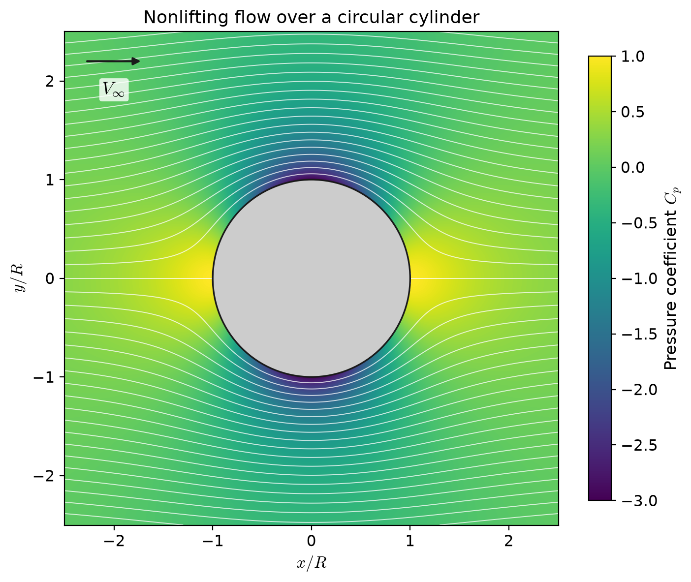
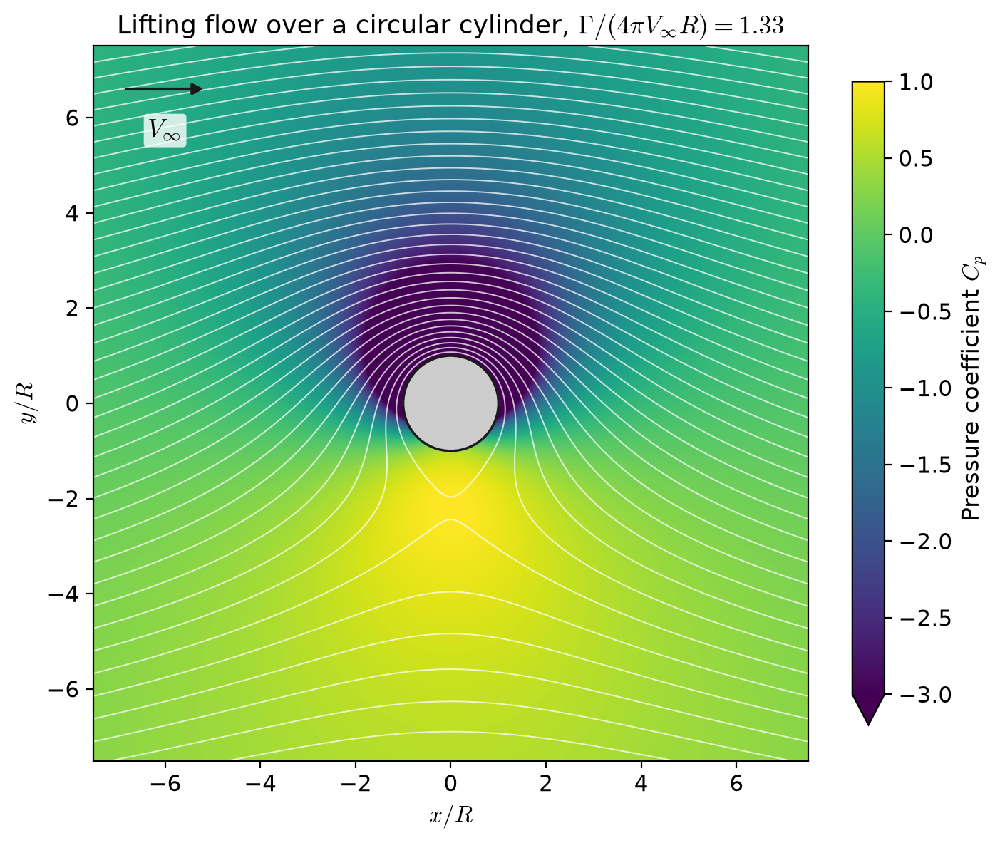

# Understanding potential flows
 
Two classic potential-flow models from J. D. Anderson, *Fundamentals of Aerodynamics*: the nonlifting flow over a circular cylinder, and the lifting flow over a cylinder with circulation. Each script builds the stream function by superposing elementary flows, computes the velocity field numerically, and plots the streamlines together with the pressure coefficient.
 
## Background
 
Potential flow assumes the fluid is inviscid, incompressible and irrotational. The flow can then be described by a stream function $\psi$, whose contours are the streamlines. The elementary flows used here (uniform flow, doublet and vortex) all satisfy Laplace's equation, which is linear, so they can simply be added together to build more complex flows.
 
The velocity components follow from the stream function, and the pressure from Bernoulli's equation:
 
$$u = \frac{\partial \psi}{\partial y}, \qquad v = -\frac{\partial \psi}{\partial x}, \qquad C_p = \frac{p - p_\infty}{\tfrac{1}{2}\rho_\infty V_\infty^2} = 1 - \left(\frac{V}{V_\infty}\right)^2$$
 
## Nonlifting flow over a circular cylinder
 

 
The flow is built from a uniform flow and a doublet, the limiting case of a source and a sink brought together:
 
$$\psi_{uniform} = V_\infty r \sin\theta, \qquad \psi_{doublet} = -\frac{\kappa}{2\pi}\frac{\sin\theta}{r}$$
 
Choosing the doublet strength $\kappa = 2\pi V_\infty R^2$ gives
 
$$\psi = V_\infty r \sin\theta \left(1 - \frac{R^2}{r^2}\right)$$
 
so $\psi = 0$ on the circle $r = R$, which makes the circle a streamline: the surface of the cylinder.
 
What the plot shows:
 
- **Stagnation points** at the front and back of the cylinder, where the flow stops and $C_p = 1$
- **Maximum speed** $2V_\infty$ at the top and bottom, where $C_p = -3$. On the surface, $C_p = 1 - 4\sin^2\theta$.
- **A symmetric pressure field**, so the cylinder feels neither lift nor drag. Zero drag contradicts experiment and is known as d'Alembert's paradox: it comes from neglecting viscosity.
## Lifting flow over a circular cylinder
 

 
Adding a vortex of strength $\Gamma$ (positive clockwise) to the nonlifting flow gives
 
$$\psi = V_\infty r \sin\theta \left(1 - \frac{R^2}{r^2}\right) + \frac{\Gamma}{2\pi}\ln\frac{r}{R}$$
 
The vortex speeds up the flow over the top and slows it down underneath, so the pressure is lower on top than below. The resulting lift per unit span is given by the Kutta–Joukowski theorem:
 
$$L' = \rho_\infty V_\infty \Gamma$$
 
The drag is still zero. The position of the stagnation points depends on the ratio $\Gamma / (4\pi V_\infty R)$:
 
| Ratio | Stagnation points |
| --- | --- |
| < 1 | Two points on the lower surface, at $\sin\theta = -\Gamma / (4\pi V_\infty R)$ |
| = 1 | The two points merge at the bottom of the cylinder |
| > 1 | A single point lifts off the surface into the flow below the cylinder |
 
The script uses $V_\infty = 30$, $R = 2$ and $\Gamma = 1000$, so the ratio is about 1.33. The stagnation point therefore sits in the flow directly below the cylinder, at
 
$$r = \frac{\Gamma}{4\pi V_\infty} + \sqrt{\left(\frac{\Gamma}{4\pi V_\infty}\right)^2 - R^2} \approx 2.2R$$
 
which is where the streamlines cross below the cylinder in the plot.
 
## Implementation
 
- **Grid:** the stream function is evaluated on a 1000 × 1000 grid. Points inside the cylinder are set to `NaN`.
- **Velocities:** computed from the stream function with `np.gradient`, which uses second-order central differences in the interior.
- **Streamlines:** drawn as equally spaced contours of $\psi$. The same volume of fluid flows between neighbouring lines, so where the lines bunch together, the flow is fast.
- **Pressure coefficient:** both plots share the same colour scale, from −3 to 1. In the lifting case, values below −3 near the top of the cylinder are clipped, which is marked by the arrow on the colour bar.
- **Plotting:** the shared style lives in `plotting.py`. Figures are saved to `figures/`.
